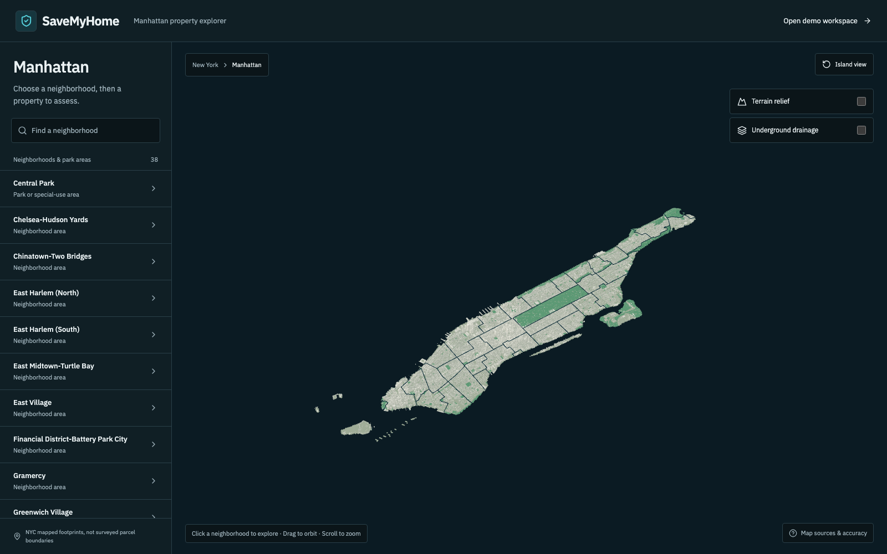
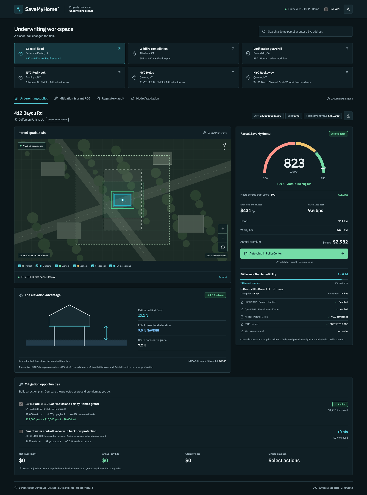
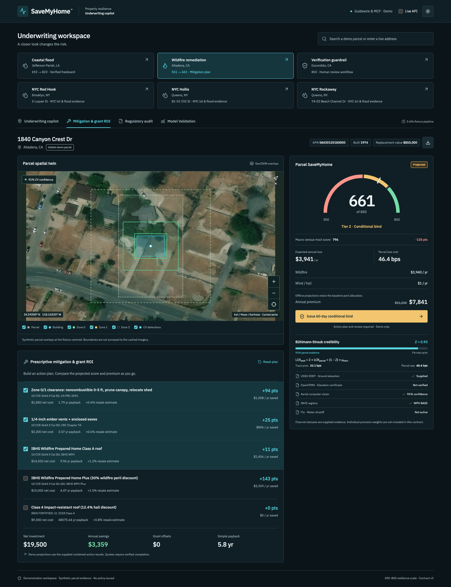

# SaveMyHome

SaveMyHome is a property catastrophe risk assessment and underwriting prototype. It combines a 300–850 parcel resilience score, a 3D property explorer, and mitigation planning to help underwriters and brokers assess a home, understand its risk, and compare improvements.

The model blends census-tract loss estimates with parcel evidence using Bühlmann-Straub credibility. The workspace shows how that evidence affects the score, expected loss, and modeled premium.



## What it does

- Explore Manhattan neighborhoods, building footprints, measured ground elevations, and drainage layers, then open a selected property's assessment.
- Review parcel hazards, flood freeboard, evidence provenance, and the difference between tract and parcel scores.
- Compare retrofit plans by combined score, investment, grant offsets, annual premium savings, and payback.
- Route change-detection alerts through human review and simulated smartphone inspection before restoring demo binding eligibility.
- Inspect model validation, regulatory evidence, and downloadable audit dossiers. Missing evidence remains unknown.

## In the workspace

| Parcel underwriting | Mitigation planning |
| --- | --- |
| [](docs/demo/screenshots/06-coastal-underwriting.png) | [](docs/demo/screenshots/09-mitigation-plan-and-roi.png) |
| Compare the tract estimate with supplied parcel evidence. | Evaluate the combined effect of a selected retrofit plan. |

Also see [human review and simulated inspection](docs/demo/screenshots/13-inspection-evidence-reviewed.png), [regulatory audit](docs/demo/screenshots/15-regulatory-audit.png), and [model validation](docs/demo/screenshots/20-model-validation.png).

Screenshots use bundled demo data. PolicyCenter receipts, smartphone verification, and regulatory evidence are demonstrations; they do not issue insurance or establish regulatory approval. Offline Manhattan assessments use cached model screening with disclosed defaults and a nonlocal reference tract. They do not rank local properties or provide quotes. The backend evidence store is in memory and resets on restart.

## Run locally

Use Node.js 20 or later. From the repository root:

```sh
cd frontend
npm ci
npm run dev
```

Open [localhost:3000](http://localhost:3000) for the Manhattan explorer or [/assessment?demo=true](http://localhost:3000/assessment?demo=true) for six bundled scenarios covering coastal flood, wildfire, verification review, and NYC flood risk. The explorer and demo flows work with the backend stopped and require no map token.

For live API requests, start the backend in a separate terminal with Python 3.11 or later and `uv`:

```sh
cd backend
uv sync
uv run uvicorn app.main:app --reload --port 8000
```

Enable **Live API** in the workspace. The frontend defaults to `http://localhost:8000`; set `NEXT_PUBLIC_API_BASE_URL` in `frontend/.env.local` to change it.

## Repository

| Path | Contents |
| --- | --- |
| [frontend/](frontend/) | Next.js 15, React 19, TypeScript, and Three.js workspace. See the [frontend guide](frontend/README.md) for walkthroughs, API behavior, and checks. |
| [backend/](backend/) | FastAPI ingestion and actuarial engine, evidence and rules registries, Guidewire mocks, and broker MCP tools. |
| [contracts/](contracts/) | Shared JSON schemas, six canonical demo scenarios, and combined mitigation results. |
| [docs/](docs/) | [Technical specification](docs/SPEC.md), [model decisions](docs/DECISIONS.md), and [benchmarks](docs/BENCHMARKS.md). Decisions take precedence over the original specification. |
