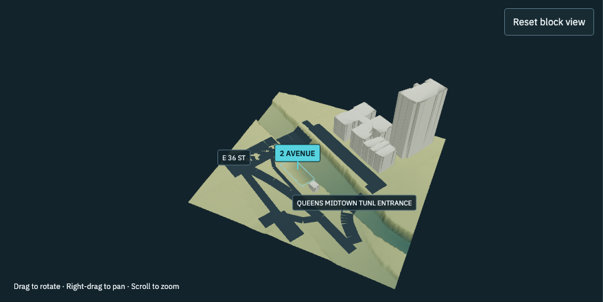
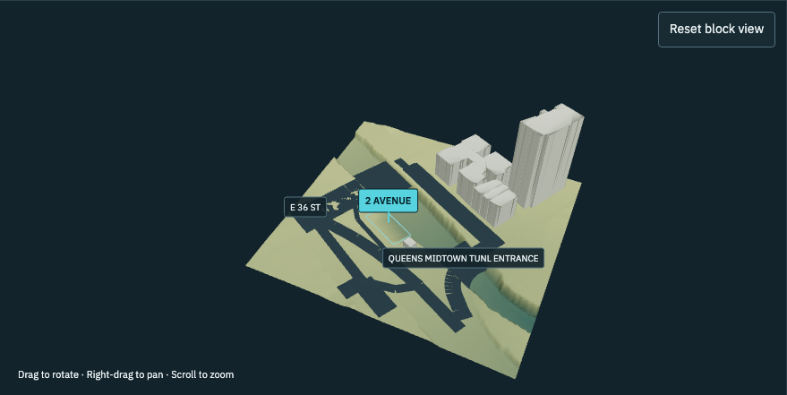

# Second Avenue tunnel-crossing correction

The reported view was inspected directly in Brave on 2026-10-18. It was **building `412518`, BIN `1085643`, tax block 942**, using the pinned USGS one-metre terrain. The earlier 2021 prototype concerned `1112075`, another footprint sharing the `2 AVENUE` tax-lot label. It did not cover the reported crossing.

## Cause and reproduction

Road ribbons sampled the bare-earth DEM at four corners every five metres and connected those heights into triangles. At an overpass, that samples the lower terrain where the road deck is absent. It creates a false road slope into the excavation. The selected building's conflict fallback also filled its footprint using varying terrain heights, producing a folded cyan sheet.

The recorded [street profiles](2ave-tunnel-profile.json) reproduce a **6.4049 m centreline change within a five-metre sampling interval** on Second Avenue segment `2208:0`. Entrance segment `79430:0` has a **5.86 m cross-road difference across its 9.14 m width**. These are renderer samples of underlying terrain, not measured roadway grades. The exact [USGS request, response and checksum](../../frontend/tests/fixtures/elevation/usgs-block-412518.json) and adjacent TIFF make the failure reproducible offline.

The focused regression command is:

```sh
cd frontend
npm exec -- tsx --test tests/manhattan-street-grade.test.ts
```

Before the fix, the synthetic upper road folded from 6 m ground down to a 0.30 m displayed road edge. A second regression caught a residual 4.94 m approach dip after initially clipping an already-deformed mesh. Splitting the road in plan before assigning elevations fixes that seam.

## Separate road decks

[NYC's planimetric capture rules](https://github.com/CityOfNewYork/nyc-planimetrics/blob/main/Capture_Rules.md#imagery-and-data-specifications) explicitly specify US survey feet and NAVD88 for all features. The [Transport Structure Polygon Z layer](https://services6.arcgis.com/yG5s3afENB5iO9fj/ArcGIS/rest/services/Transport_Structure_2022/FeatureServer/25) contains two actual bridge outlines in this area. Six [bridge elevation points](https://services6.arcgis.com/yG5s3afENB5iO9fj/ArcGIS/rest/services/Elevation_2022/FeatureServer/6) corroborate their heights. Both structures and those observations are marked `Unchanged`; their presence in the 2022 release does not establish a 2022 measurement date. No geoid realization is supplied.

| Structure | Source ID | Assigned upper street segments | Source vertex elevations |
| --- | --- | --- | --- |
| 205 | `12230000009` | `79426:0`, `79430:0` | 3.2231–4.8260 m |
| 206 | `12230000010` | `2208:0`, `2207:0`, `2114:0`, `2113:0` | 7.1956–7.5951 m |

These are all bundled street ribbons/centrelines intersecting the two decks, independently enumerated. Only those six explicit associations are clipped. Unassociated lower roads retain their lower elevations. The two nearby code-2310 tunnel portal polygons are excluded from deck construction; they do not describe tunnel interiors.

The renderer triangulates the source Polygon Z outlines, preserving their varying vertex heights. Associated road ribbons are split at the exact deck boundaries first. New approach vertices at a boundary use that deck's height; other supported vertices use terrain. This avoids interpolation from a lower-ground sample beneath the deck into the upper approach. Street labels use only their associated deck when appropriate. Decks share the existing road geometry/material draw, and triangulations are cached. No per-frame state or continuous rendering was introduced.

Ground raster values remain unchanged. Decks are never used to sample building ground, terrain metrics or underwriting inputs. Display lifts remain separate from source measurements: roads/decks use the existing 0.30 m road lift and outline graphics use 0.20 m. These are rendering offsets, not elevation observations.

The bounded [public asset](../../frontend/public/manhattan/context/transport-decks.json) is **11,880 bytes**, with SHA-256 `bde3fbd2a6dbd18f1224a573a67e345c580226b1464fa2504b5b3bceaa6167de`. It adds two known crossings rather than a citywide bridge inventory. [Compact evidence](2ave-transport-evidence.zip) contains the complete bounded service responses, metadata and capture rules, totaling 44,317 bytes compressed. No large elevation download was needed.

## Selected building

Building `412518` overlaps neither bridge. The closest deck is 3.776 m away; moving the building onto it would assign an unsupported base. Its original **6.1 m source ground and 5.79 m height remain unchanged**. No roof elevation point in the bounded 2022 subset lies within its footprint. The nearest roof point is 53.41 m away and is unsuitable for assigning its roof.

Conflicting buildings now retain a **flat outline**, without a filled footprint or solid extrusion. The outline uses the building's recorded ground when available; otherwise it uses the highest sampled perimeter value as an explicitly labeled display reference. The selected building base reads **Unresolved across ground levels**. Terrain beneath its footprint is still listed as context, and first-floor elevation remains unknown. This avoids pretending that low tunnel-floor samples establish the building's foundation.

## Validation

- Lint, production build and all 78 unit tests passed. Four focused street tests cover the original fold, approach seam, lower-road separation and exact recorded crossing. The real-crossing test raycasts the rendered geometry, checks that the upper street no longer appears on the lower ground, preserves the raw terrain, checks source associations and verifies the unwarped outline and unchanged building values.
- An offline replay from a freshly unpacked evidence archive reproduced the public bridge asset byte-for-byte.
- Full production-build browser suite: **58 passed, one live-backend test skipped, no failures or flaky results**. New desktop/mobile cases use building `412518` and its exact recorded raster. They compare the same scene with bridge data disabled/enabled, verify the unresolved source-base outline, and exercise orbit/zoom, reset, theme changes, tab remount and narrow layouts. Existing selection, drainage, relief, GPU-resource reuse, zero-idle-render, underwriting, demo verification/binding and export regressions pass. [Browser results](2ave-tunnel-browser.json).
- An independent agent verified the two source polygons, all six street associations, bridge-point alignment, source dates/units limitations and absence of bridge/roof evidence for the selected building. Boundary versus bridge-point heights differ by up to 4.38 cm; the points corroborate the outlines rather than defining identical constraints.

Rebuild the bounded asset offline after extracting the evidence ZIP, or add `--fetch` to refresh the small public-service queries:

```sh
python frontend/scripts/build-manhattan-transport.py --cache /private/tmp/2ave-transport-replay
```

Other multi-level crossings need their own structure coverage. Sparse bridge boundary heights do not establish road crown, deck thickness, abutments or current survey accuracy. The underlying DEM can still show historical noise and excavation contours. This correction separates the known upper roadway from ground beneath it; it does not certify the entire terrain or building placement.

## Matched views

These screenshots compare the same camera and viewport with the source decks disabled and enabled. Both use the corrected flat-outline treatment for the unresolved building, isolating the road-deck change. They are a visual regression comparison, not an accuracy survey or timing benchmark.

| Ground-draped roads, source decks disabled | Separate sourced decks and corrected approach joins |
| --- | --- |
|  |  |

[Rotated view](2ave-tunnel-orbit.png) · [Mobile view](2ave-tunnel-mobile.png)
