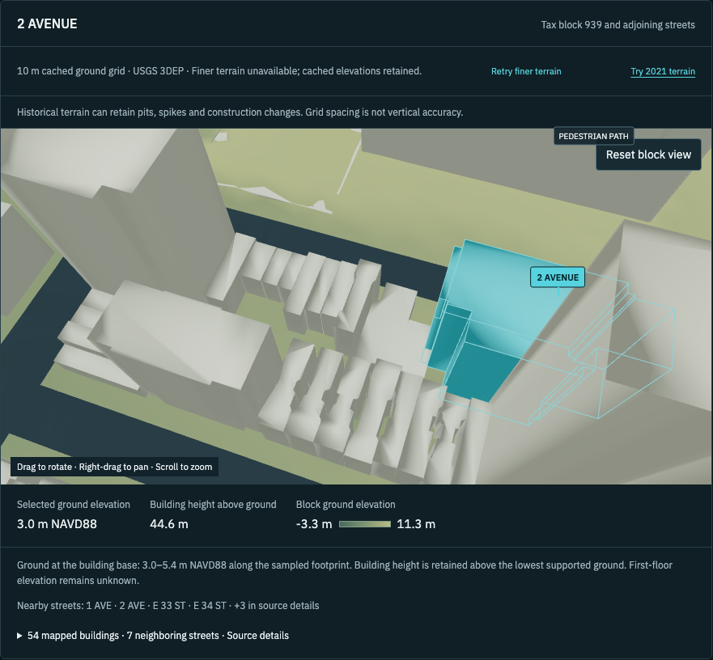
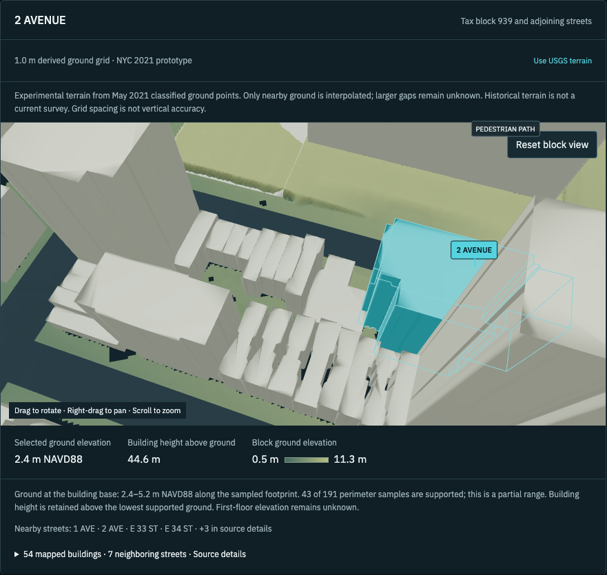

# NYC 2021 Murray Hill terrain prototype

Built and validated 2026-10-18 for building `1112075`, labeled `2 AVENUE`. The [source investigation](nyc2021-evaluation.md) established the acquisition, coordinate system and classification differences. This implementation adds an optional terrain layer for that building's 54-building context. USGS remains the default and the cached 10 m ground remains the failure fallback.

In the building assessment, select **Try 2021 terrain** above the scene. **Use USGS terrain** restores the previous source. The choice survives workspace tab changes and is reflected in `terrain=nyc2021` in the assessment URL. A saved assessment is still required to open that URL. No citywide source switch, assessment mutation, contract change, package addition or build/export configuration change is included.

## Derived surface

Two source LAS files were streamed without saving the complete files. Their full-file hashes match the evaluated survey. The builder retained 2,065,330 local non-withheld class-2 ground and class-8 model-key points. Class 7, class 18 and building returns are excluded. All source coordinates use the exact US survey foot conversion `1200/3937` to metres.

The output is a 452 × 373 Float32 GeoTIFF on the earlier audit's common grid. Horizontal coordinates are EPSG:4326; elevations are metres NAVD88/GEOID18. Pixel-centre georeferencing is retained. It uses a linear TIN with all of these support limits:

- Nearest classified ground point within 3 m.
- Triangle maximum edge at most 10 m.
- Triangle circumradius at most 5 m.
- No extrapolation beyond the triangulation.

Triangulation runs in 64 × 64 query patches with a 10.01 m halo. Coincident XY returns retain an observed upper median height. These are prototype choices, not a vertical accuracy specification. The browser verifies the manifest, extent and SHA-256 before decoding, reuses the decoded grid on subsequent switches and rejects out-of-coverage requests. Larger unsupported gaps remain NoData. No smoothing or blanket pit filling is applied.

| Check | Result |
| --- | --- |
| Supported raster cells | 104,102 / 168,596, or 61.75% |
| NoData cells | 64,494 |
| Probe A, older USGS pit | TIN +2.8081 m |
| Probe B, disputed 2017 depression | TIN +6.1849 m; nearest ground 2.4601 m away |
| Selected building centre | Unknown; nearest ground 11.5569 m away |
| Selected supported perimeter | 43 / 191 samples, +2.3547 to +5.2258 m |

Probe B's low returns still exist in the 2021 cloud around −4.63 m and are classified as noise. The prototype interpolates surrounding ground across that small gap. This demonstrates a classification-dependent surface, not that the physical depression was removed or necessarily erroneous. Site observations or survey are still needed to resolve it.

All 54 mapped buildings and their source heights remain. The selected building's 44.65 m source height is retained above the lowest supported perimeter ground. That partial perimeter does not establish its surveyed foundation, roof or first floor. Five neighboring buildings have no supported 2021 perimeter samples and retain their existing source-ground estimates: `147888`, `333955`, `582861`, `624579`, `803801`. None use a zero-height fallback in this context. The view states the supported perimeter count and explains source-ground fallback in source details.

## Disk and transfer

| Item | Bytes |
| --- | ---: |
| Source network transfer, two streamed LAS files | 829,729,520 |
| Temporary terrain files before cleanup | 39,557,205 |
| Remaining scratch evidence after ground-crop cleanup | 1,772,978 |
| Bundled GeoTIFF | 317,812 |
| Bundled manifest | 1,360 |

The approximately 40 MB temporary file total fits the proposed 100 MB data budget. Full LAS files were never stored. The existing isolated Python environment was reused; a fresh environment adds roughly 250 MB separately. These totals cover terrain files, excluding the existing frontend dependencies, build cache and test screenshots.

The [build report](nyc2021-prototype.json) records complete source hashes and derived values. The public manifest and raster are in `frontend/public/manhattan/prototypes/`.

## Validation

- Four scientific tests passed, covering raw probe records, withheld/noise exclusion, upper-median duplicates, rejection of long/skinny triangles, planar interpolation and preservation of input points.
- Lint and production build passed. All 74 frontend unit tests passed. The prototype unit test reads the actual bundled GeoTIFF, checks corrupt-byte and invalid-unit rejection, unsupported ground, cache reuse, cancellation, out-of-coverage rejection, finite geometry and preservation of all 54 source buildings/heights.
- Full production-build browser suite: **56 passed, one live-backend test skipped, zero failures or flaky results**. Existing map selection, drainage, relief, geometry reuse, picking, underwriting, verification/binding demos and exports passed their regressions.
- New desktop and mobile tests cover fully local 2021 loading with USGS networking blocked, asset failure/retry, source toggling three times, orbit/zoom, unchanged camera after each round trip, selected labels, retained building height, reset, light theme, tab remount, cache reuse and narrow-screen layout.
- Both viewports fetched the TIFF once, reused the decoded grid and recorded zero additional WebGL draw calls during a 600 ms idle observation after camera damping settled. Existing scene rendering remains demand-driven.
- An independent agent verified raster hashes, coordinate units and pixel centres; reproduced the probe elevations and NoData; checked the halo/support rules; and independently audited all 54 building placements. It identified the partial perimeter coverage and five source-ground fallbacks documented above. No blocking errors were found.

The [browser evidence](nyc2021-prototype-browser.json) records Chromium 156.0.8078.4 on the actual **ANGLE/Vulkan SwiftShader software backend**, at desktop 1440 × 1000 and mobile 390 × 844. Local TIFF resource loads measured 16.6 ms and 8.7 ms respectively. Navigation-to-status readiness was 2.90 s and 2.59 s under the concurrent regression run. These are local functional-run observations, not a matched before/after performance benchmark or hardware GPU timing. The recorded repeated source-switch durations include explicit idle-settling waits and must not be interpreted as display FPS, render-submission time or GPU time.

An additional standalone `npx tsc --noEmit` check still reports existing fixture typing errors in `tests/e2e/evidence-status.spec.ts` and `tests/e2e/nyc.spec.ts`. Those files are unchanged. The production build's checks and executable suites pass.

## Screenshots

The orbit comparison uses the same camera and viewport. USGS is the cached 10 m fallback with its external service deliberately blocked, not a native 2017 or detailed USGS raster. Terrain support and source notes intentionally differ. Dark gaps in the prototype are unsupported terrain rather than zero-height ground. All buildings remain visible.

| Cached USGS, orbit | 2021 prototype, same orbit |
| --- | --- |
|  |  |

[Initial desktop view](nyc2021-prototype-2021-initial.png) · [Mobile light view](nyc2021-prototype-2021-mobile.png)

## Reproduction

Use the existing isolated environment or install `frontend/scripts/nyc2017-evaluation-requirements.txt` into a separate environment. From the repository root:

```sh
python frontend/scripts/build-nyc2021-terrain.py --cache /private/tmp/nyc2021-prototype-build --fetch
python frontend/scripts/test_nyc2021_terrain.py
```

The build streams about 830 MB over the network, writes the small derived assets/report and removes its full local ground crops after success. Omit `--fetch` only if those temporary crops are already available. Scientific tests use the committed compact raw-probe archive and need no download.

From `frontend/`:

```sh
npm run lint
npm run build
npm test
npm run test:e2e
```

The prototype remains historical, bounded and experimental. Its spacing and reported survey-wide accuracy do not establish present-day ground accuracy, certified first-floor elevation, freeboard or a validated risk-model input. The current sources stay available for comparison.
